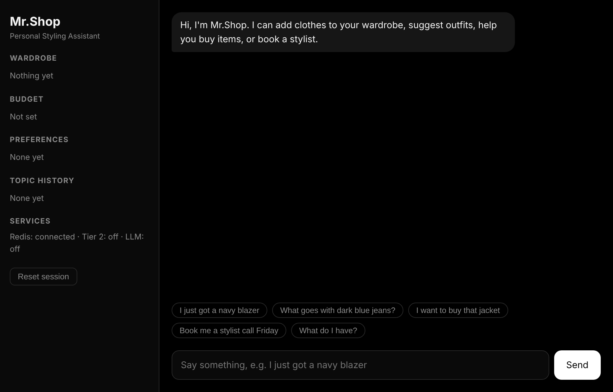
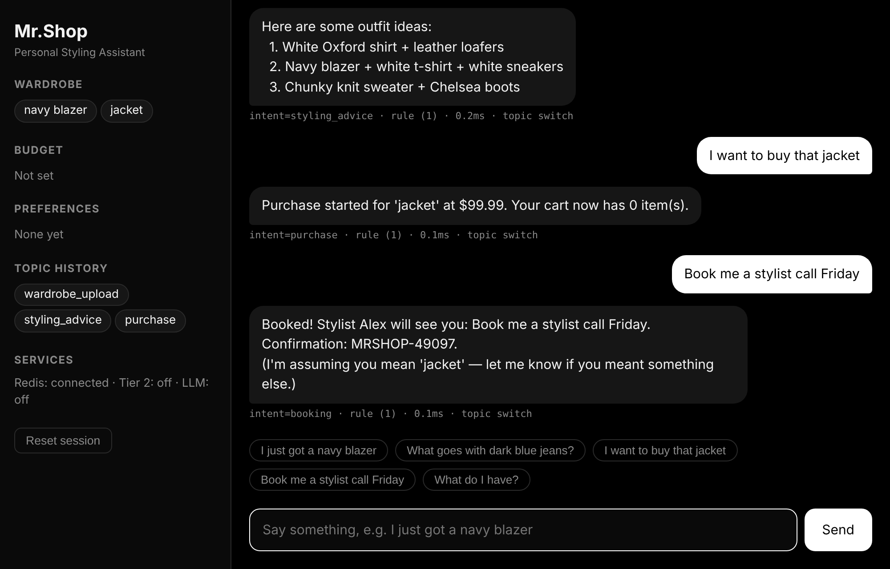
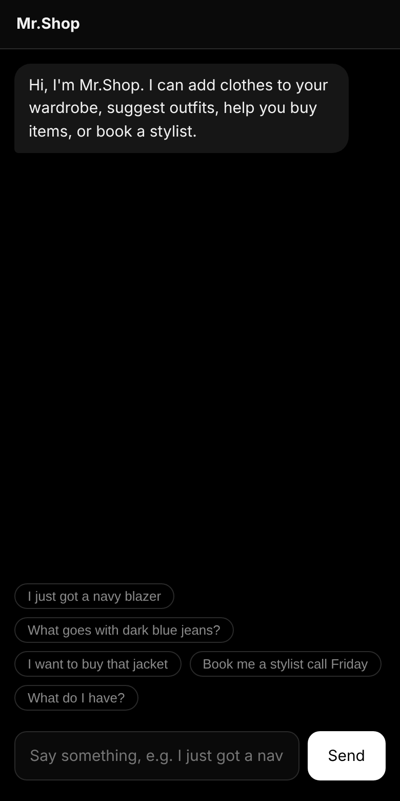
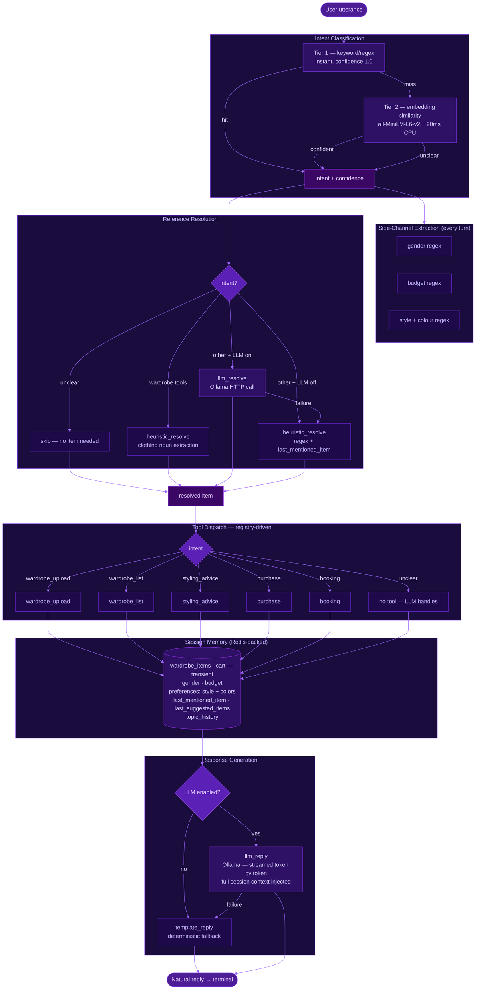

<div align="center">

# Mr.Shop

**Talk to your personal styling assistant. Add clothes to your wardrobe, get outfit advice, buy items and book a stylist, all in one conversation.**

*Terminal agent with Redis memory, plus a simple chat website.*

<br>


-000000?logo=ollama&logoColor=white)


<br>



</div>

<br>

## What it does

You talk to it naturally. It figures out what you want, remembers the context, and replies:

- **wardrobe**: add items ("I just got a navy blazer") and list them
- **styling advice**: outfit ideas based on what you own
- **purchase**: "buy that jacket" is resolved to the right item from context
- **booking**: book a stylist call
- **memory**: gender, budget, style and colour preferences, last mentioned item and topic history are kept for the whole conversation and across restarts

<div align="center">

</div>

## Features

- **Three-tier intent classification.** Tier 1 is keyword/regex (instant). Tier 2 is embedding similarity with `all-MiniLM-L6-v2`. Anything unclear goes to the LLM or a template reply.
- **Reference resolution.** "it", "that" and "the jacket" are mapped to a real item using the last suggested or last mentioned item.
- **Ambient memory.** Gender, budget and preferences are picked up from any message, whatever the intent.
- **Redis sessions.** State is saved after every turn with a 24 hour TTL, keyed by user. If Redis is down it runs in memory only.
- **Optional LLM.** With Ollama running, replies are streamed token by token. Without it, deterministic template replies are used.
- **Plugin registry.** A new intent is one file with one `register()` call. No change to the classifier or orchestrator.
- **Turn trace.** Every turn reports intent, source, confidence, resolver and latency per stage.
- **Chat website.** A small FastAPI + HTML page (`web/`) that shows the same pipeline in a chat UI, with live session memory in the sidebar.
- **Mobile friendly.** The chat page works on phone and laptop.

<div align="center">

</div>

## Architecture



**Request flow**

1. The utterance goes to Tier 1 (regex). On a miss it goes to Tier 2 (embeddings). On a second miss it is `unclear`.
2. Gender, budget and style/colour are extracted on every turn and written to memory.
3. The reference resolver maps pronouns to an item (heuristic, or Ollama if enabled).
4. The tool for the intent runs and updates the session.
5. The reply is generated (LLM, or template fallback) and the session is saved to Redis.

## Tech stack

| Part | Choice |
|---|---|
| Language | Python 3.13, managed with uv |
| Classification | Regex rules + `all-MiniLM-L6-v2` (sentence-transformers) |
| LLM (optional) | Ollama, `llama3.2:3b` |
| Session store | Redis 7+ |
| Terminal UI | Plain REPL (`mrshop/conversation/repl.py`) |
| Web demo | FastAPI + one HTML file |
| Tests | pytest, pytest-asyncio, fakeredis |

## Privacy

- Everything runs on your machine. Redis keeps your session (wardrobe, budget, preferences, topic history) for 24 hours.
- With Ollama enabled, text goes only to your own Ollama server.
- No external API is called.

## Project structure

```
.
├── mrshop/
│   ├── config.py             # Startup wiring: picks resolver + reply generator
│   ├── classifier/           # tier1.py (regex), tier2.py (embeddings), resolver.py
│   ├── generator/reply.py    # template_reply and streaming llm_reply
│   ├── memory/session.py     # Session schema and typed helpers
│   ├── storage/redis_store.py# Load / save session, TTL, multi-user
│   ├── tools/                # registry.py, wardrobe, styling, purchase, booking
│   ├── orchestrator/         # Routes each turn, side-channel extraction, trace
│   └── conversation/repl.py  # Terminal REPL
├── web/
│   ├── server.py             # FastAPI wrapper around the orchestrator
│   └── index.html            # Chat page
├── tests/                    # pytest suites (Redis and Ollama are mocked)
├── images/                   # Screenshots
├── DESIGN.md                 # Example conversations and design decisions
└── pyproject.toml
```

## Run it yourself

**Prerequisites:** Python 3.13, [uv](https://docs.astral.sh/uv/), Redis 7+ (`sudo apt install redis-server`). Ollama is optional (`ollama pull llama3.2:3b`).

**1. Install**

```bash
uv sync
```

**2. Terminal version**

```bash
uv run mrshop                        # auto: uses Ollama if reachable
LLM_ENABLED=false uv run mrshop      # template mode, no Ollama needed
MRSHOP_USER_ID=alice uv run mrshop   # separate session per user
```

**3. Chat website**

```bash
uv pip install fastapi uvicorn
uv run uvicorn server:app --app-dir web --port 8000
```

Then open `http://localhost:8000`.

### What you can say

| What you want | Example |
|---|---|
| Add an item | "I just got a navy blazer" |
| See your wardrobe | "What do I have?" |
| Styling advice | "What goes with dark jeans?" |
| Buy something | "I want to buy that jacket" |
| Book a stylist | "Book me a stylist call Friday" |
| Set a budget | "My budget is $200" |
| Preferences | "I love minimalist style" |

### Environment variables

| Variable | Default | Purpose |
|---|---|---|
| `LLM_ENABLED` | `auto` | `true`, `false` or `auto` (pings Ollama) |
| `OLLAMA_HOST` | `http://localhost:11434` | Ollama address |
| `OLLAMA_MODEL` | `llama3.2:3b` | Model for replies |
| `TIER2_THRESHOLD` | `0.33` | Embedding confidence cutoff |
| `REDIS_URL` | `redis://localhost:6379` | Redis connection |
| `REDIS_TTL` | `86400` | Session expiry in seconds |
| `MRSHOP_USER_ID` | `local` | Session key per user |

### Tests

```bash
uv run pytest -q
```

Redis (fakeredis) and Ollama are mocked, so no services are needed.

## Status

- Intent classification, memory, tools and Redis sessions: **done**
- Terminal REPL with streaming and turn trace: **done**
- Chat website demo: **done**
- Screenshots in this README were taken with LLM off and Tier 2 off (Tier 1 rules + template replies)

## Ideas for later

- Real product catalogue instead of fixed prices
- Image upload for wardrobe items
- Streaming replies in the web UI

## Author

Built by [Sarang](https://github.com/sarangKP).
